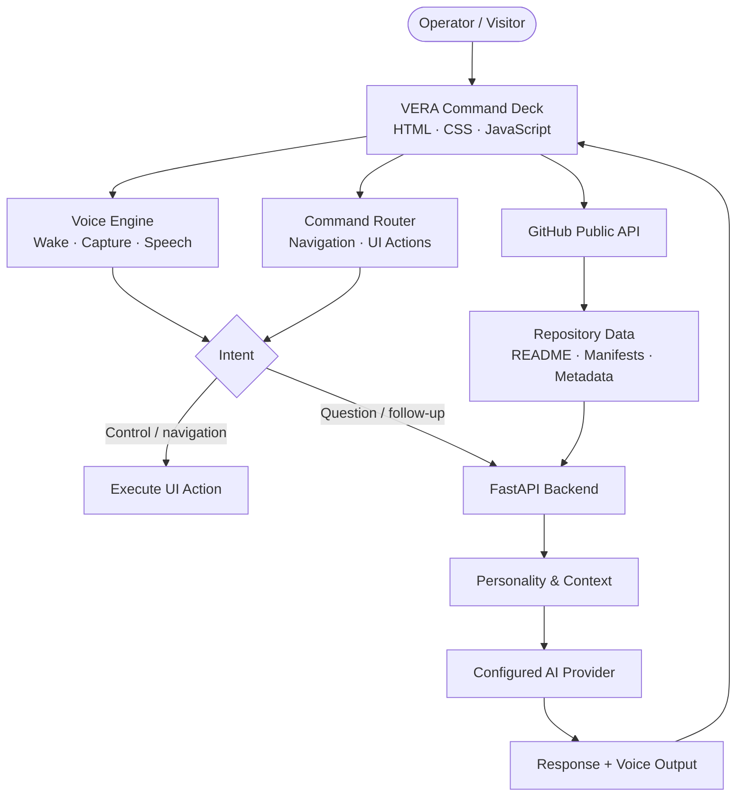

<div align="center">


# V E R A

### **VOICE-ENABLED RECONNAISSANCE & ASSISTANCE**

**A cinematic, voice-first engineering command deck.**  
Not another portfolio. A living interface for exploring projects, inspecting architecture, and talking to your code.

<br />

<a href="https://prathmeshmante-glitch.github.io/">
  
</a>
<a href="https://github.com/prathmeshmante-glitch">
  
</a>

<br /><br />

> *“Systems nominal. Intelligence online. What shall we inspect?”*

</div>

---

<div align="center">

| **VOICE** | **INTELLIGENCE** | **RECONNAISSANCE** | **CONTROL** |
|:---:|:---:|:---:|:---:|
| Hands-free wake loop | LLM-powered responses | Live public GitHub data | Voice + HUD actions |
| `Vera` / `Hey Vera` | Multi-provider backend | Repository context | Navigate by command |

</div>

## ◈ THE EXPERIENCE

Vera is an original personal engineering assistant with a cinematic **obsidian / reactor-gold / telemetry-cyan** interface. She can listen for a wake phrase, respond in a natural voice, answer technical questions through a configured AI backend, and help explore public engineering repositories.

<table>
<tr>
<td width="50%" valign="top">

### ◉ 01 — Voice Core
- Wake-word standby and hands-free command capture
- Spoken answers with browser speech synthesis
- Pause, resume, mute, repeat, and stop controls
- Recovery handling for recognition interruptions

</td>
<td width="50%" valign="top">

### ⌘ 02 — Engineering Intelligence
- Open-ended questions through a configured LLM
- Conversation-aware follow-ups
- Honest degraded mode when AI is unavailable
- Distinction between deterministic controls and AI answers

</td>
</tr>
<tr>
<td width="50%" valign="top">

### ⌬ 03 — Mission Archive
- Live public repository discovery
- Project selection and repository context
- README and dependency-manifest inspection
- Architecture explanations and comparisons

</td>
<td width="50%" valign="top">

### ⛨ 04 — Personality & Boundaries
- Vera introduces herself as **Vera** (VEER-uh)
- Respectful operator mode when authenticated
- Professional visitor interactions
- Protection for credentials and private information

</td>
</tr>
</table>

## ◈ SYSTEM BLUEPRINT



### Stack

<div align="center">


</div>

## ◈ VOICE LIFECYCLE

```text
  ENABLE LISTENING
        │
        ▼
   ┌───────────┐      "Vera" / "Hey Vera"
   │  STANDBY  │ ──────────────────────────┐
   └───────────┘                           ▼
        ▲                           ┌─────────────┐
        │                           │ WAKE DETECTED│
        │                           └──────┬──────┘
        │                                  ▼
        │                           ┌─────────────┐
        │                           │ CAPTURE CMD │
        │                           └──────┬──────┘
        │                                  ▼
        │                           ┌─────────────┐
        │                           │ PROCESS / AI│
        │                           └──────┬──────┘
        │                                  ▼
        │                           ┌─────────────┐
        └───────────────────────────│ SPEAK ANSWER│
                                    └─────────────┘
```

**Design principle:** one activation, repeated hands-free turns, explicit user control. Browser recognition can still disconnect or be throttled; the interface must report its real state instead of pretending to listen.

## ◈ QUICK START

### 1. Clone the command deck

```bash
git clone https://github.com/prathmeshmante-glitch/prathmeshmante-glitch.github.io.git
cd prathmeshmante-glitch.github.io
```

### 2. Configure the backend

Use Python 3.10+ and create a virtual environment:

```bash
python -m venv .venv
# Windows PowerShell:
.\.venv\Scripts\Activate.ps1
# macOS / Linux:
# source .venv/bin/activate

python -m pip install --upgrade pip
python -m pip install -r backend/requirements.txt
```

Create `backend/.env` from `backend/.env.example` and add **one** supported provider key, for example:

```dotenv
GEMINI_API_KEY=your_key_here
# Or use OPENAI_API_KEY=... / GROQ_API_KEY=...
```

**Never commit real API keys.** Keep secrets on the server, not in frontend JavaScript or a public repository.

### 3. Start the API

From the repository root:

```bash
python -m uvicorn backend.app.main:app --host 127.0.0.1 --port 8000 --reload
```

Check the API at [http://127.0.0.1:8000/health](http://127.0.0.1:8000/health) and explore [API docs](http://127.0.0.1:8000/docs).

### 4. Serve the frontend

Open a second terminal from the repository root:

```bash
python -m http.server 5500
```

Visit [http://127.0.0.1:5500](http://127.0.0.1:5500).

> **Public deployment note:** GitHub Pages serves the static frontend; it does not run the FastAPI backend. To enable real LLM responses on the public site, deploy the backend separately, configure its secrets securely, and set the frontend's backend URL to that deployed service.

## ◈ TEST & VERIFY

Run the backend tests:

```bash
python -m pytest backend/tests/test_api.py -v
```

Run the full-system acceptance checks:

```bash
python tests/test_full_system.py
```

The repository's latest engineering report records **18 backend tests** and **14 acceptance checks**. Mocked LLM tests verify routing behavior, not the availability of a real provider; verify the live backend separately.

## ◈ SAFETY & REALITY CHECKS

- Microphone access requires a user gesture and permission.
- Wake-word standby applies while the supported browser page is active; a closed browser cannot provide dependable always-on listening.
- Browser speech recognition may rely on a platform speech service and may require network access.
- An AI response requires a reachable backend and valid provider credentials.
- Operator privileges must not rely solely on a spoken name or frontend-only flag.
- Repository analysis should be grounded in fetched public data; uncertain claims should be labeled as inferences.

## ◈ ROADMAP

- [x] Cinematic command-deck interface
- [x] Managed voice lifecycle and wake-word matching
- [x] Dynamic AI routing with honest unavailable-provider behavior
- [x] Repository navigation actions
- [ ] Verify the complete wake → ask → answer → standby loop in target browsers
- [ ] Deploy and health-check the production AI backend
- [ ] Add a custom operator hologram and alternate holographic visual modes

---

<div align="center">

### BUILT TO EXPLORE. DESIGNED TO RESPOND.

**Vera** · Personal Engineering Intelligence  
[Launch the interface](https://prathmeshmante-glitch.github.io/) · [Explore the source](https://github.com/prathmeshmante-glitch/prathmeshmante-glitch.github.io)

<sub>Interface visuals and browser capabilities vary by device, browser, permissions, and backend configuration.</sub>

</div>
